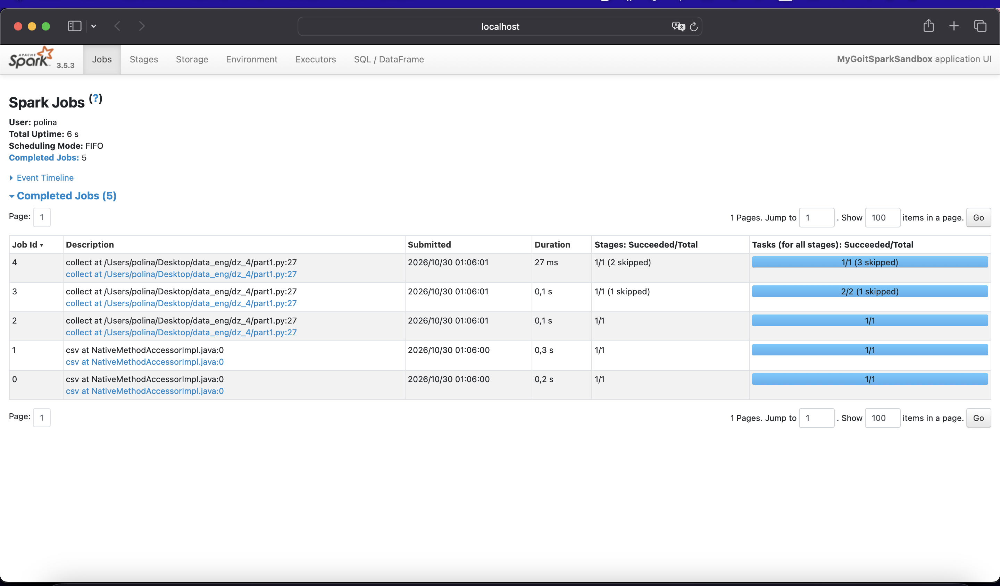
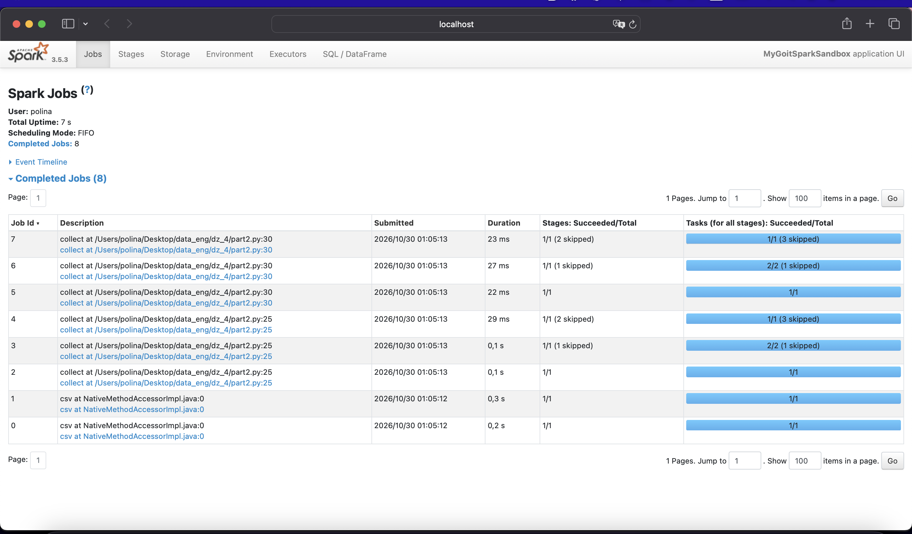
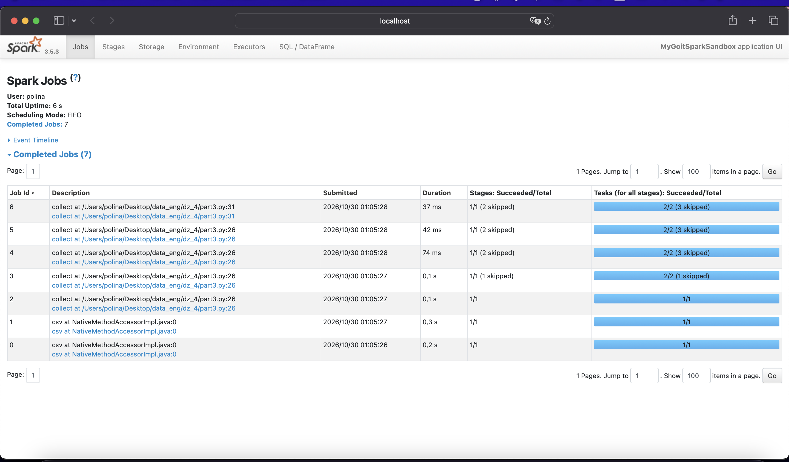

# goit-de-hw-04 — Apache Spark. Оптимізація та SparkUI

Три варіанти однієї програми над датасетом `nuek-vuh3.csv` і аналіз кількості Jobs на сторінці SparkUI (`http://localhost:4040/jobs/`).

Запуск (Python 3, Java 17, з кореня репозиторію):

```bash
pip install -r requirements.txt
python part1.py   # далі part2.py, part3.py
```

Поки програма чекає на `Press Enter...`, SparkUI доступний на `http://localhost:4040/jobs/`.

Spark 3.5.3, `local[*]`, `spark.sql.shuffle.partitions = 2`, Adaptive Query Execution увімкнено (за замовчуванням).

## Частина 1 — 5 Jobs

[part1.py](part1.py): одна дія `collect()` наприкінці.



- **Job 0, 1 — `csv`**: виконуються ще під час `spark.read.csv(...)`, а не під час дії. Один прохід читає заголовок (`header=true`), другий — увесь файл, щоб визначити типи колонок (`inferSchema=true`).
- **Job 2, 3, 4 — `collect`**: план має два shuffle (`repartition(2)` і `groupBy("unit_id")`), тому AQE виконує його послідовними етапами:
  - Job 2 — читання CSV, фільтр `final_priority < 3` і `select`, shuffle для `repartition(2)`. Оптимізатор переносить фільтр нижче за `repartition` і проштовхує його прямо в читання (`PushedFilters: [LessThan(final_priority,3)]`), тому в shuffle потрапляє лише 70 рядків;
  - Job 3 — часткова агрегація `count` і shuffle для `groupBy` (етап попереднього job показано як *skipped*, його результат перевикористано);
  - Job 4 — фінальна агрегація `count`, фільтр `count > 2` і повернення результату драйверу.

## Частина 2 — 8 Jobs

[part2.py](part2.py): додано проміжний `collect()` до фільтра `count > 2`.



- Job 0, 1 — читання CSV, як у частині 1.
- Job 2, 3, 4 (`part2.py:25`) — проміжний `collect()`: увесь ланцюжок `repartition → where → select → groupBy → count`.
- Job 5, 6, 7 (`part2.py:30`) — фінальний `collect()`.

**Чому на 3 Jobs більше.** Трансформації в Spark ліниві, а DataFrame не зберігає обчислених даних — лише план. Кожна дія (action) заново виконує обчислення цього плану. Проміжний `collect()` — це ще одна дія над тим самим ланцюжком, тож Spark удруге виконує ті самі три етапи (читання з фільтром і shuffle для `repartition`, shuffle для `groupBy`, фінальна агрегація). Два CSV-jobs не повторюються: схему визначено один раз під час `read`. Звідси 3 додаткові Jobs, а не 5: 5 + 3 = 8.

## Частина 3 — 7 Jobs

[part3.py](part3.py): проміжний результат агрегації позначено `.cache()`.



- Job 0, 1 — читання CSV.
- Job 2–5 (`part3.py:26`) — перший `collect()` на `nuek_processed_cached`:
  - Job 2, 3 — ті самі два shuffle, що й без кешу (`repartition` і `groupBy`);
  - Job 4 — фінальна агрегація `count`, результат якої записується в кеш (InMemoryRelation, 2 партиції);
  - Job 5 — сам `collect`, який читає вже з кешу.

  Без кешу «фінальна агрегація + повернення результату» — один Job. З кешем це два послідовні Jobs: «заповнити кеш» і «прочитати з кешу». Тому перша дія має 4 Jobs замість 3 — це плата за наповнення кешу.
- Job 6 (`part3.py:31`) — фінальний `collect()` після `where("count > 2")`: лише **один** Job, бо дані беруться з кешу. Попередні етапи показано як *skipped* — вони не виконувались повторно.

**Чому з `cache()` Jobs менше.** Без кешу друга дія повторює весь ланцюжок обчислень (3 Jobs у частині 2). З `cache()` результат агрегації після першої дії вже лежить у пам'яті, і друга дія лише фільтрує готові рядки — 1 Job. Разом: 2 (читання) + 4 (перша дія з наповненням кешу) + 1 (друга дія) = 7 замість 8.

`cache()` має сенс, коли той самий DataFrame використовують кілька дій: дорогі кроки (читання, shuffle, агрегація) виконуються один раз. Після роботи кеш звільняють через `unpersist()`, як це зроблено в кінці `part3.py`.
